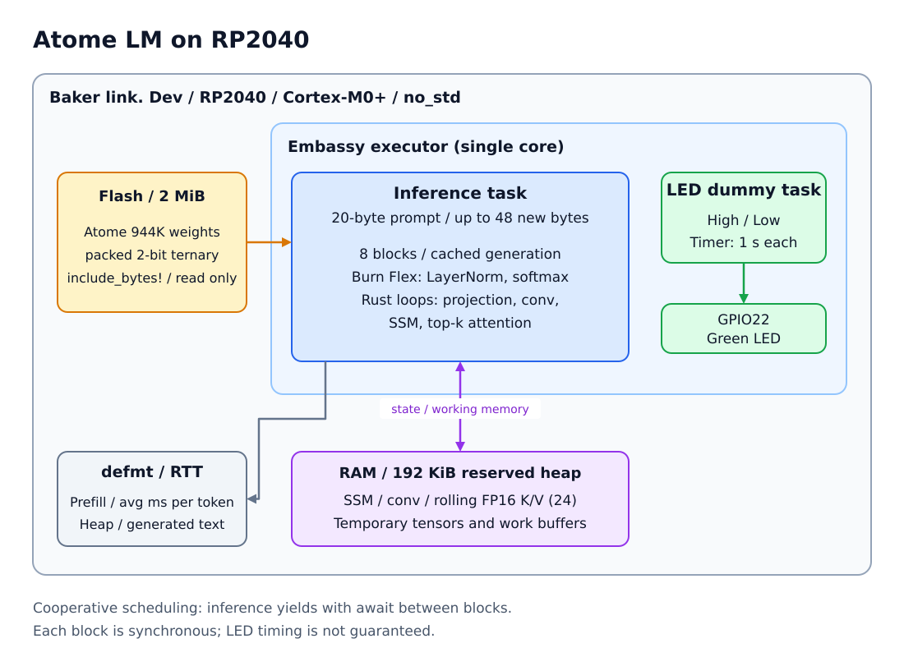

## はじめに

Rustの組み込み開発で、マイコン上の推論に挑戦してみました。

今回動かすのは、公開されている約94万パラメータの言語モデル「Atome LM」です。RP2040上で、Rustの機械学習フレームワークBurnのFlexバックエンドを使って推論します。

推論の状態をキャッシュしながら、短い英文の続きを生成する構成です。Embassyで別の処理も並行して動かす例として、LEDを点滅させるダミータスクも入れています。大きなモデルを動かす記事ではありませんが、「マイコンでモデルを動かすには、どこが大変なのか」を確かめる題材になりました。

## 今回の構成

- ボード: Baker link. Dev（RP2040）
- CPU: Cortex-M0+
- Flash: 2 MiB
- SRAM: 256 KiB
- Rust: 1.94.1
- Burn / Burn Flex: 0.21.0
- Embassy: `embassy-rp` 0.10、`embassy-executor` 0.10
- モデル: Atome LM 944,640パラメータ

Atome LMは2-bitの三値重みを使う小さなモデルです。モデルファイルはFlash上に置き、推論時に重みを読み出します。語彙数は256で、**1バイトを1トークンとして扱います**。

今回のファームウェアの設定は次のとおりです。

| 項目 | 設定 |
| --- | --- |
| 固定プロンプト | `Once upon a time, in`（20バイト） |
| 追加生成数 | 最大48トークン（48バイト） |
| 停止条件 | `.`、`!`、`?`、改行のいずれか、または生成数の上限 |
| 各層が保持するK/Vキャッシュ | 最大24トークン分 |
| 推論用ヒープ | 192 KiB |

**24は生成全体の長さ制限ではなく、K/Vキャッシュの保持数です。** 古いK/Vを捨てることで、24トークンを超えても生成を続けられます。出力は別途固定長バッファへ保存し、このデモでは最大48トークンの追加生成で止めます。

このモデルは日本語の対話や汎用チャットを目的としたものではありません。今回の固定プロンプトも英語の短い文字列です。

### 全体の構成図



*モデルはFlashから参照し、推論中の状態はRAMに保持します。推論タスクと、並行処理のダミーであるLEDタスクを、同じコア上で協調的に実行します。*

図の推論タスクでは、Burn Flexの演算と専用Rustループを組み合わせています。推論ブロックの間に`await`を入れ、そのタイミングでLEDタスクにも実行を譲ります。処理時間やヒープ使用量は、`defmt` / RTT経由で確認できる構成です。

:::message
構成図はSVGファイルひとつにまとめ、draw.ioの編集データも埋め込んでいます。同梱の`images/atome-lm-architecture.svg`をdraw.io（diagrams.net）で開くと編集できます。上の相対パスはローカルプレビュー用です。Zennへ投稿する際は、画像をアップロードして発行されたURLに置き換えてください。投稿先がSVGに対応していない場合は、draw.ioからPNGなどに書き出してアップロードしてください。
:::

## Burnとは

[Burn](https://burn.dev/)は、**Rustで書かれた機械学習・深層学習フレームワーク**です。多次元配列である「テンソル」の演算やニューラルネットワークを扱う機能があり、モデルの学習と推論の両方に利用できます。

特徴の1つが、実際に演算する部分を「バックエンド」として切り替えられることです。CPUやGPUなど、実行先に合ったバックエンドを選べます。今回は、Rustで実装されたCPU向けバックエンドの**Burn Flex**を使います。

### `no_std`でも使える

Burnは、対応するバックエンドと機能を選ぶことで、Rustの標準ライブラリ`std`を使わない**`no_std`環境にも対応**しています。そのため、今回のようなOSのないマイコン上でも推論に利用できます。ただし、すべてのバックエンドや機能が`no_std`で使えるわけではありません。

このプロジェクトでは、次のようにデフォルト機能を無効にし、Flexバックエンドを有効にしています。

```toml
burn = { version = "=0.21.0", default-features = false, features = ["flex"] }
burn-flex = { version = "=0.21.0", default-features = false, features = ["critical-section"] }
```

`burn-flex`の`critical-section`機能は、Cortex-M0+でCAS（比較交換）命令を使えないことに対応するための設定です。

なお、**`no_std`は「ヒープを使わない」という意味ではありません**。今回の実装は`alloc`を使い、テンソルや状態キャッシュを動的に確保するため、アロケータとヒープ領域が必要です。この点は、後述の「ヒープの確保」で説明します。

### 今回はBurn Flexと専用Rustループを組み合わせる

ただし、テンソル演算をすべてそのまま使うと、Cortex-M0+では小さな演算の呼び出しや一時テンソルの生成が負担になります。そこで、三値重みのprojectionやAttentionの小さな行列積など、処理時間が気になる部分は専用のRustループにし、LayerNormやsoftmaxなどはBurn Flexで計算する構成にしました。

CエンジンやFFIを呼び出すのではなく、推論処理をRustのコードで実装しているのが今回のポイントです。

## Embassyで推論とダミータスクを並行して動かす

`inference_task`がモデルのロードと文章生成を担当します。一方、`green_led_task`は**並行処理のために用意したダミータスク**です。推論処理に必要な機能ではなく、「推論以外の処理も一緒に動かす」例としてGPIO22の緑LEDを点滅させています。将来、センサーの取得や通信処理などを並行して動かす場面をイメージした構成です。

LEDのコードは、HighとLowの切り替えごとに1秒待機します。タスクを登録する部分は次のようになっています。

```rust
#[embassy_executor::task]
async fn green_led_task(mut led: Output<'static>) {
    info!("Green LED task started (1s interval)");
    loop {
        led.set_high();
        Timer::after_millis(1000).await;
        led.set_low();
        Timer::after_millis(1000).await;
    }
}

// main内で、ヒープとGPIOを初期化したあとに登録する部分
spawner.spawn(green_led_task(green_led).unwrap());
spawner.spawn(inference_task().unwrap());
```

推論側では、1トークンを処理する関数を`process_token`として切り出しました。8層のブロックを順番に処理し、各ブロックのあとに`await`を入れます。この関数はプロンプトの読み込みと、生成したトークンの処理で共用します。

```rust
async fn process_token(generation: &mut CachedGeneration<'_, '_>, token: u8) {
    generation.start_token(token).unwrap_or_else(|e| {
        defmt::panic!("Invalid token: {}", Debug2Format(&e));
    });
    for _ in 0..8 {
        generation.step().unwrap_or_else(|e| {
            defmt::panic!("Cached block inference failed: {}", Debug2Format(&e));
        });
        Timer::after_millis(1).await;
    }
}
```

ここでの「並行」は、別コアで同時に計算する並列実行ではなく、**同じコア上で処理を譲り合う協調的な実行**です。各ブロックの演算自体は同期処理なので、その間にLEDタスクが実行されるわけではありません。`await`で実行を譲ることで他のタスクを進められますが、LEDの正確な周期やリアルタイム性は保証していません。

## プロンプトから文章の続きを生成する

まずモデルを読み込み、キャッシュ付きの生成状態を作ります。以下は初期化部分の抜粋です。

```rust
let model = Atome::load(MODEL_BYTES).unwrap_or_else(|e| {
    defmt::panic!("Model load failed: {}", Debug2Format(&e));
});
let prompt = b"Once upon a time, in";
let mut generation = model.cached_generation(CONTEXT).unwrap_or_else(|e| {
    defmt::panic!("Invalid generation window: {}", Debug2Format(&e));
});

for &token in prompt {
    process_token(&mut generation, token).await;
}
```

プロンプトを順に読み込む処理を**prefill**と呼びます。prefill後は、モデルが出力した256個のlogits（次のバイトのスコア）のうち、最大のものを次のトークンとして選びます。これがgreedy生成です。

選んだトークンを出力バッファに追加し、さらに続きを生成する場合は、そのトークンを`process_token`へ渡します。これを最大48回繰り返します。

モデル固有の終了トークンで止めるのではなく、このデモでは次の条件で打ち切ります。

```rust
if matches!(next as u8, b'.' | b'!' | b'?' | b'\n') {
    info!("Stopped at sentence end after {} tokens", index + 1);
    break;
}
if index + 1 == MAX_NEW {
    break;
}
```

句点なども出力に含めて終了します。これは文末らしい文字を使う簡易的な停止方法であり、文章としての完結を保証するものではありません。終了後は推論タスクが完了し、LEDのダミータスクは動き続けます。

## ヒープの確保

RP2040はメモリが限られるため、推論用のヒープを192 KiBに設定しています。モデルの重みはバイナリ全体をRAMへコピーせず、`include_bytes!`でFlash上のデータを参照します。

```rust
const HEAP_SIZE: usize = 192 * 1024;
static HEAP: LlffHeap = LlffHeap::empty();
static mut HEAP_MEMORY: [MaybeUninit<u8>; HEAP_SIZE] =
    [MaybeUninit::uninit(); HEAP_SIZE];

#[global_allocator]
static ALLOCATOR: Allocator = Allocator;

#[embassy_executor::main]
async fn main(spawner: Spawner) {
    unsafe {
        HEAP.init(
            core::ptr::addr_of_mut!(HEAP_MEMORY) as usize,
            HEAP_SIZE,
        )
    };
    // ...
}
```

上のコードはヒープ初期化部分の抜粋です。実際の`Allocator`は、確保と解放を`LlffHeap`へ委譲し、ヒープ不足時のログ出力や使用量の高水位の記録も行います。

この192 KiBは推論中に必ずすべて使うという意味ではありません。一方で、リンカ上はヒープ領域として固定で確保するため、スタックなどに使えるRAMの余裕を圧迫します。READMEに記録されたreleaseビルドの静的RAM使用量は約194 KiBですが、実機でのスタック高水位やヒープ断片化はまだ測定できていません。

## トークンごとの状態をキャッシュする

プロンプト全体をトークン生成のたびに最初から計算すると、生成するたびに処理量が増えてしまいます。そこで、各層の状態を保持し、次のトークンでは新しいトークンだけを処理するキャッシュ付き生成を実装しました。

キャッシュするものは、主に次の3つです。

- SSMのhidden state
- 因果畳み込みの直近4つの入力
- AttentionのKey / Value

Key / Valueはメモリを抑えるためFP16で保持します。そのため、キャッシュが満杯になる前でも、FP32で全系列を再計算した場合とlogitsが完全一致するわけではありません。

### K/Vキャッシュをローリングさせる

各層のK/Vキャッシュは最大24トークン分を保持します。満杯になったら、現在トークンのAttentionを計算したあとに最古のK/Vを取り除き、新しいK/Vを追加します。したがって、計算時には最大24個の過去トークンに現在トークンも加わりますが、処理後に保持するのは24個です。

このローリング方式により、生成を続けてもK/Vの保持数は増え続けません。SSMの状態はリセットせず引き継ぎ、畳み込みの履歴も直近4入力を保持します。ただし、古いトークンのK/VはAttentionから参照できなくなるため、窓を超えた生成は全系列再計算と同じ結果にはなりません。長く生成した場合の文章品質はまだ評価していません。

K/Vだけで必要な容量は、8層合計で1トークンあたり約5 KiBです。24トークン分では約120 KiBになり、これにSSM状態、畳み込み履歴、一時テンソルなどが加わります。ヒープ192 KiBに収めるため、保持数を24にしています。

## RTTで何を確認するか

現在のログは、以前のようなブロックごとの時間や全token IDの表示ではなく、次の情報に絞っています。

- 起動時のK/V保持数、最大追加生成数、ヒープ容量
- prefillしたバイト数と所要時間
- 生成中、8トークンごとの平均`ms/token`
- 文末文字で打ち切った場合の生成トークン数
- 最終的なヒープ使用量と高水位
- プロンプトを含む最終バイト列
- 有効なUTF-8なら`Generated text:`として文字列、不正なUTF-8ならエラー位置

平均`ms/token`は、decode開始からの経過時間を途中までの生成数で割った簡易的な指標です。ログ出力や各ブロック後の1 ms待機も含むので、純粋な演算時間ではありません。また、最初の出力トークンはprefillの結果から選び、最後の出力トークンは続きが不要なので再入力しません。prefill時間とあわせて見る必要があります。

## ビルドと実行

このプロジェクトではBaker Linkの既存の`Baker Link: Debug`構成を使います。

1. Baker Link Envを起動し、ホスト側でRunします。
2. Baker link. Devを接続します。
3. VS Codeからビルド・デバッグを実行します。既存構成では、デバッグ開始前に`cargo build`が実行されます。

ファームウェアの書き込みとボードのリセットを伴います。速度を確認するときはreleaseビルドを使います。debugビルドとreleaseビルドでは実行速度が大きく異なるため、debugの計測値を性能評価に使わないようにします。

なお、既存のデバッグ構成が参照するのはdebug版のELFです。`cargo build --release`を実行しただけでは、F5で書き込むファームウェアがrelease版に切り替わるわけではありません。

ビルドが通ることと、実機で推論が完走することは別です。実機ログを確認し、モデル生成やLEDの動作を確かめてください。

## ホストでの検証

実機だけで正しさを確かめるのは難しいため、ホスト上でもNumPyの参照実装と比較します。NumPy側は同梱バイナリを独立に読み出してlogitsを計算します。元のPyTorchチェックポイント自体との比較ではなく、Cエンジンも使いません。

リポジトリでは次のコマンドで参照生成とテストを実行できます。ヒープ計測用のカウンタはテスト間で共有するため、ここではテストを1スレッドで実行します。

```sh
uv run --with numpy==2.4.6 python scripts/reference.py

cargo test --lib --test burn_parity \
  --target x86_64-unknown-linux-gnu \
  --no-default-features --features host-tests -- --nocapture --test-threads=1
```

NumPyとの比較は、1バイトの入力、通常の文字列、16バイトの入力、非ASCIIバイトなどを含む既存の8ケースです。256個すべてのlogitsとargmaxを比較し、許容誤差を`2e-4 + 2e-5 * abs(reference)`に設定しています。現在のK/V保持数は24ですが、この参照fixtureの入力が24バイトまで網羅されているわけではありません。

キャッシュ付き生成のテストでは、入力を1トークンずつ処理し、24トークンまでの各prefixで全系列再計算と比較します。その先もトークンを処理し、ローリング後のlogitsが有限値であることを確認します。これは、窓を超えても正しく文章を書けることを保証するテストではありません。

ヒープ用の別テストでは、窓を超えて繰り返し処理したときのピーク要求量が192 KiB未満であることを検証します。アロケータの管理領域、断片化、スタック使用量はこの測定に含まれません。

今回、上記のホストテストを実行し、単体テスト4件と比較・キャッシュ関連テスト3件が成功しました。主な結果は次のとおりです。

| 確認項目 | ホストテストの結果 |
| --- | --- |
| NumPy参照との比較（8ケース） | 最大logits絶対誤差 約`9.1e-6`、argmax一致 |
| キャッシュと全系列再計算の比較（24トークンまで） | 最大logits絶対誤差 約`1.93e-3`、argmax一致 |
| 窓を超えるキャッシュ処理のピークヒープ要求量 | 173,644 bytes（約170 KiB）、192 KiB未満 |

これらはホストでの数値検証であり、RP2040実機での処理速度やピークRAMの測定結果ではありません。

既存のテストには、`Once upon a`からの先頭4バイトが` tim`になることの確認も残っています。これは短い入力での回帰テストであり、現在のファームウェアのプロンプト`Once upon a time, in`からの生成結果ではありません。

## RAMと速度について

READMEに記録されたCエンジン版の固定推論配列の見積もりは、`max_seq=24`で約160 KiBです。一方、今回のBurn版のローリングキャッシュ用ホストテストでは、ピーク要求量は約170 KiBでした。固定配列の見積もりとホストの動的確保量では条件が異なり、RP2040上での直接比較でもないため、これだけでどちらが省メモリかは結論できません。

さらに、Burn版では192 KiBのヒープ領域を静的に予約しており、ファームウェア全体のRAM余裕は小さくなります。実機のピークヒープ、スタック、処理速度、tokens/secは今後確認する項目です。

現在の方式の実機生成結果や速度は、まだ確認できていません。古い全系列再計算方式の実機ログや、ホストでの処理時間を現在のファームウェアの性能として扱わず、release版でprefill時間、生成中の平均時間、ヒープ高水位を改めて確認する必要があります。

## 最後に

今回は、Burn Flexを使った`no_std`推論、Embassyによるタスク実行、限られたRAM上での状態キャッシュを組み合わせて、RP2040で小さな言語モデルを動かす構成を作りました。

現在は固定プロンプトから文末文字または最大48トークンまで生成するデモです。K/Vは24トークン分をローリングさせ、SSM状態などを引き継ぐことで、キャッシュの保持数を超えて処理を続けられるようにしました。LEDタスクは、推論と別処理を並行して動かすためのダミーです。

対話入力やUSB CDCは実装していません。また、ローリング後の文章品質、実機での速度やスタック使用量も今後の確認項目です。

一方で、ホストでの参照実装との比較や状態キャッシュのテストを用意したことで、実機に載せる前に演算の正しさを確認できるようになりました。今後はrelease版を実機で動かし、推論時間とRAM使用量を測定していきたいと思います。

## 参考

- [Atome LM](https://github.com/TilelliLab/atome-lm)（モデルとライセンスの詳細は配布元および同梱ライセンスを参照）
- [Burn](https://burn.dev/)
- [Embassy](https://embassy.dev/)
- [Rust✖️組み込みで非同期処理（async）をしてみた（Embassy）](https://zenn.dev/baker_link_lab/articles/705de547cc7077)
